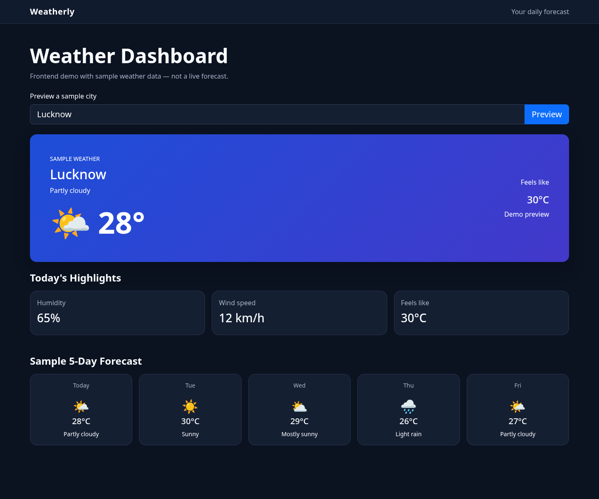

# Weatherly

A responsive weather dashboard frontend demo built with HTML, CSS, Bootstrap, and vanilla JavaScript. It uses hard-coded sample data to demonstrate the interface and city picker; it does not fetch live weather.

## Preview

## Run locally

Open `index.html` in a browser, or serve this folder with a local static web server. Select Lucknow, London, or Tokyo to preview the sample weather cards.

## Publish with GitHub Pages

Push the project to a GitHub repository, then select **Settings → Pages → Deploy from a branch**, choose the `main` branch and `/ (root)`, and save. GitHub Pages will provide the public site URL.

## Stack

- HTML
- CSS
- Bootstrap 5
- Vanilla JavaScript
